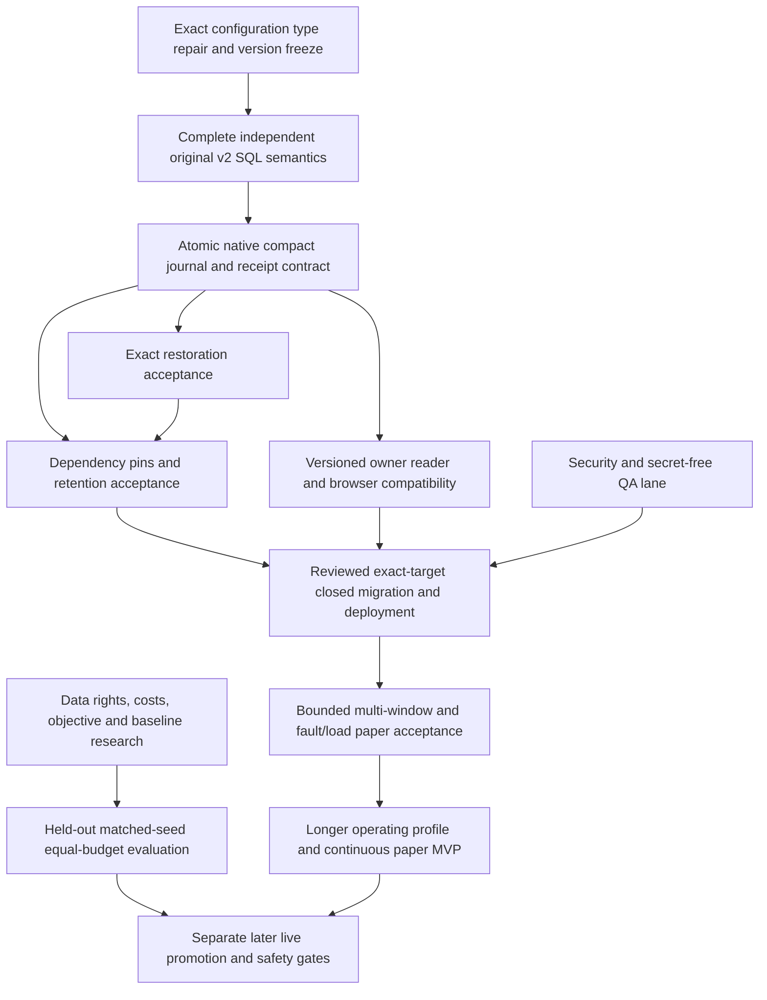

# Dashboard audit review and revised execution plan — 2026-10-12

The additions are not all verified correct. The core finite paper pilot and many
offline invariants have credible evidence, but this review reproduced a strict
configuration defect, confirmed active dashboard/Nestegg defects, found current
dependency advisories and corrected contradictory status documents. The updated
[TODO](TODO.md) is the execution plan; this report explains its evidence and limits.

## Scope and evidence standard

Reviewed source baseline: main `67cff30e82d6847a6d1b3f03276308646e8083a4`
(PR97), with PR96 already merged. Three independent read-only reviews covered
evolution/SQL/version boundaries, app/release behavior and backlog dependencies.
Current ordinary tests, typecheck, lint, isolated build, advisory scans and exact
target/read-only release checks supplement source inspection. A passing test
means its tested behavior passed; it does not certify untested paths or a hosted
runtime. Source findings are distinguished from actual reproductions and prior
hosted evidence below.

This pass changes documentation and a credential-free defect evidence artifact.
It does not fix runtime code, install packages, apply migrations, provision
credentials, activate Railway, submit paid provider requests or operate wallets.
The pre-existing colonies migration and the other coding agent's files, tools,
credentials and processes remain preserved.

## What is built and supported by evidence

| Area | Supported conclusion | Remaining boundary |
| --- | --- | --- |
| Original engine repairs and minimal genome | Versioned fitness/drawdown, common evaluation windows, causal candles/indicators, risk/lifecycle and fixed two-EMA controls have substantive regression/rehearsal coverage. | Initial GA paper MVP stays two genes, eight members, one SOL/USD reference market. Broader all-solver/multi-colony acceptance and added genes remain separate. |
| Original hosted v5 paper pilot | Owner hour revision 514:504 accepted prices, one full GA replacement, eight retired founders/equally funded children, two closed trades,32 contiguous acknowledged events. Exact total paper cash1000.146507473480244672414802117408 USD; repaired owner history/repeat reads passed. | Zero execution costs and one replacement prove mechanics, not meaningful profit, multi-window durability or continuous operation. [Original evidence](supabase/audits/2026-10-08-owner-hour-first-replacement.json). |
| Hosting and access | Exact Railway service exists and is restored to ordinary closed deploymentcf05895d-adc5-427f-873e-82ad6606e5a1. Source implements owner/Auth/origin checks, finite native capabilities, bounded strict controls, no-store and liveness-only health. Dockerfile has a pinned base/hash lock/non-root process; entrypoint uses one exec/lifespan-enabled process. | Current service-settings reads do not retest image contents, native TLS or active workload; those retain their prior bounded evidence. No continuously evolving worker is enabled. |
| Compact foundations | Offline component/hash/numeric/locked-resolution, economics, source/causal/risk and assessment proofs exist. Graph/RNG/selection/recorded-parentage proof is a bounded partial gate. | Existing optimizer SQL explicitly reports completed mutation unproved; child periods copied from the request are not independent mutation verification. [Partial SQL](services/vonneumann/db-contract/research/optimizer_transition.sql). |
| Mutation portability | Original Gaussian math differences were measured; separately versioned integer proposal has independent Python/SQL primitive comparisons and source-bound traces. | Distribution/draw/rate changes are explicit model changes. Primitive agreement is not complete model SQL admission, profitability or a compatible reinterpretation of old runs. |
| Portable v2 model/transport | Nine focused cases pass again, including three seeds/four synthetic windows each, recorded sexual/asexual lineage, fixed controls, version isolation and Stop/restart behavior. Seventy legacy wire pairs retain old hashes. Current artifact source hashes match. | Reproduced typed-policy defect below prevents full strict-validation acceptance. Complete independent original-v2 SQL, native effects, decoder/restoration and hosted selection remain open. [Model scope](services/vonneumann/NATIVE-PORTABLE-GA-MODEL.md). |
| Paper UI | Curated v5 reads preserve exact numeric balances, owner history and explicit unavailable states. Useful source-level component/hook regressions exist. | Pageversion1/durability 5 and ancestryversion 2 restart_clone are distinct version namespaces. Reader lacks portable model/operator/assessment metadata and multiple-window contract; VM tests are not browser/React/Auth/TLS acceptance. |

The source-bound portable artifact correctly keeps full SQL/native/restoration/
hosted/performance authority false. These flags must remain false until their
corresponding gate has actual acceptance evidence. Historical completed child
tasks do not imply completed parent/native/live milestones.

## Confirmed defects and priority changes

### P1 worker prerequisite: strict policy types

Both [research v1 configuration reconstruction](services/vonneumann/vonneumann/research/provider_ga_model.py)
and [portable v2 reconstruction](services/vonneumann/vonneumann/research/provider_portable_ga_model.py)
use ordinary dictionary equality against reconstructed configuration. Python
considers `False == 0`. A fresh in-process bootstrap/capture, replacement of
`engine.config.lifecycle_policy.max_lifespan_seconds` integer 0 with boolean False,
correct component rehash and complete owned manifest resolution accepts the
boolean in both versions. No local command is accepted and no hosted state is
involved. [Reproducer procedure and ten exact source hashes](services/vonneumann/research/2026-10-12-config-type-review.json).

Fix portable v2 with type-preserving canonical comparison or explicit schemas,
including nested boolean/integer/float/string cases, before full SQL admission.
Decide v1 compatibility explicitly and preserve old evidence. The existing nine
passing tests do not include this substitution. PAPER-COMPACT-TYPE1 is the first
worker repair; B2A remains checked only for its built versioned model/transport
scope, with the defect qualification attached.

### P1 parallel app lane: account isolation and result identity

[Nestegg draft storage](src/lib/nestegg/storage.ts) uses one origin-wide
`nestegg-draft-v1` key, without owner identity. Authenticated hydration and autosave
can load a previous account's draft when the new account has no saved plans.
[refreshCloudScenarios](src/app/(dashboard)/nestegg/page.tsx) also publishes replies
without checking the captured account/session revision. The main hydration
effect has a cancellation guard; this separate action does not. This is a
confirmed source path, not a newly executed two-user browser test.

NEST-06A must isolate owner drafts, define safe handling for anonymous/unowned
drafts and reject all old-session replies. Account A/B switching, logout,
no-saved-plan and unavailable-storage tests are required. It does not wait for
financial-model research.

NEST-05A must bind deterministic/light/full Monte Carlo results and exports to
account/session/input/model/seed identity. `fullMcStale` only partly protects
exports; insights/cards and retained light fallback can still combine older
results with current inputs during debounce or worker completion. Fix state
identity first; research distribution/calibration separately.

### P1 parallel app lane: truthful actions and API validation

- [Home](src/app/(dashboard)/page.tsx) imports mocks while its ticker says Live
  Feed. [Analytics](src/app/(dashboard)/analytics/page.tsx) describes mock series
  as user metrics and includes fixed AI/performance claims. APP-01 must identify
  fixtures and remove unsupported recommendations. Mock backtest trades ignore
  important strategy/timeframe/symbol inputs and use zero starting equity,
  allowing invalid drawdown; a real evaluator depends on validated data/costs.
- [Reports](src/app/(dashboard)/reports/page.tsx) reports generated/downloadable
  success after a timeout without an artifact. [Settings](src/app/(dashboard)/settings/page.tsx)
  reports profile/preference/upgrade/disconnect success without operations.
  APP-02 may close a narrow honest unavailable/demo flow without implementing
  every integration immediately. Success must correspond to a real outcome.
- [Test GET](src/app/api/v1/test/route.ts) accepts parseInt prefixes, invalid and
  negative limits. [Sentiment](src/app/api/v1/sentiment/route.ts) checks date shape
  rather than calendar validity and leaves text/array sizes unbounded. APP-03
  needs strict request/configuration failures before DB access. No tracked
  market_sentiment definition was found: reconcile exact schema dependencies;
  this is not proof the deployed table is absent.

### P1/P2 Nestegg calculation lane

These original defects remain active; the bot's progress does not fix them.

| Existing task | Confirmed behavior | Required acceptance/order |
| --- | --- | --- |
| NEST-01 | [Projection horizon](src/lib/nestegg/projections.ts) uses max terminal age minus primary age. Primary60/spouse40, both ending90, gets30 rather than50 years; Monte Carlo inherits it. | One household calendar, asymmetric-age examples across deterministic/MC/charts. Freeze shared timeline before dependent calculations. |
| NEST-02 | [Cash flow](src/lib/nestegg/retirement-cashflow.ts) inflates today's-dollar spending only from retirement, omitting working years. | Explicit real/nominal units/base dates, hand-worked retirement-delay examples. |
| NEST-03 | [Savings solver](src/lib/nestegg/future-value.ts) converts impossible `-1` to zero, can round required savings down, refuses some growth-only timelines; valid zero returns are floored. Goal probabilities use fixed buckets/retirement instead of goal date. | Truthful impossible/indeterminate states, preserve zero inputs, goal-date probability only from a validated matching model. |
| NEST-04 | Windfalls occur after retirement snapshot; RMD removes wealth without representing unspent transferred cash; chart spouse/survivor timing differs from main cash flow. | Shared ordered ledger, conservation/timing fixtures; RES-05 specification and authoritative tax/benefit assumptions before prescriptive changes. |
| NEST-05 | MC seeds change with all inputs and monthly returns are clipped±8%; current and retained result identities mix. | P1 state identity first; P2 researched tails/distributions/common random comparisons before calibrated confidence claims. |
| NEST-06/07 | Plan/portfolio-link provenance and popup/export completion remain broader open cases. | Link/override/zero-portfolio/account transitions and actual exported matching values/error reporting. |

RES-05 research can run now alongside privacy repairs. Correct calendar/units and
shared ledger contracts then order finance implementation. Independent fixtures
and reference comparisons are needed; this review does not certify retirement
probabilities, taxes or investment conclusions.

### P1 parallel security/QA lane

Fresh npm scans find six full-graph/one production affected package entries from
two advisories. [source-map-js](https://github.com/advisories/GHSA-68fv-2mgg-jv7q)
1.2.1 is in PostCSS/@tailwindcss/node paths, with reviewed fix 1.2.2.
[braces](https://github.com/advisories/GHSA-vfj7-8cjw-p6xm)3.0.3 is in the dev-only
Next ESLint plugin→fast-glob→micromatch path and has no listed patch. Review input
reachability and compatible changes; npm's proposed Next 14 downgrade is rejected.
Counts describe advisory dependency propagation, not demonstrated HTTP exploits.
[Detailed current dependency review](DEPENDENCY-REVIEW.md).

Next/config 16.4.0 are now stable; installed 16.3.8 is not latest. The [October 8
Next notice](https://nextjs.org/blog/upcoming-nextjs-security-update-october-2026)
announces October 14 fixes for two critical / one high upstream issues, with full
impact/ranges/instructions pending. Prepare SEC-05B response; do not assume16.4.0
fixes undisclosed issues or assert installed-version exploitability prematurely.

QA-01 is open: no `.github` workflows and no explicit test/typecheck package
scripts exist. Add credential-free pinned-runtime CI now, separating ordinary
tests from opt-in owned SQL/image jobs. Actual browser/React account/storage/Auth
and native paper acceptance must complement VM/source tests. Do not feed
production credentials to CI or preview write tests.

## Ordered worker path and parallel joins

Restoration and retention design/fixtures can overlap native implementation
after model/component versions freeze. Their final proof needs durable original
receipts and dependency pins. Reader fixtures can start from an agreed projection
draft; real browser/native compatibility joins the frozen installed package.
Final source/lease checks, original-ID uncertain submission reconciliation,
history/outbox and reserved Stop remain atomic native acceptance requirements.
Fold PAPER-ASSESSMENT-PROVENANCE1 into the new native projection rather than
inventing a separate incompatible history migration.

Parallel now: SEC-05/QA-01, NEST-06A/05A, APP-01/02/03, RES-05, data/cost/objective/
baseline research and HOST-02C. Separate file ownership/branches; merge/recheck
one section at a time. Linked Supabase operations and cloud
migrations/cutovers/credential changes/activation remain sequential and scoped.

[Railway's current IaC guidance](https://docs.railway.com/infrastructure-as-code)
was rechecked: legacy railway.json/toml reading ends2026-12-01. Prepare the
existing-project/service migration now; do not wait behind the optimizer chain,
create a replacement project or change shared billing. $20/month is the approved
pilot design ceiling, not an enforced account spending control.

Deep research deliverables remain required: representative/frozen data and
provider rights/availability, realistic liquidity/fees/slippage, source ordering
and quota/metering tails (Dashboard is TheOrder's only consumer), mutation
rate/radius/clamping/no-op/diversity and objective sensitivity, multi-seed equal
budget GA/grid/random/fixed/cash/passive holdouts, restoration/retention/native
resource tails and financial-model assumptions. Research that finds no GA
advantage is a valid result; adding genes or another optimizer is not a success
criterion. Custody/risk/token-atomic contracts and unsigned fixtures may be drafted in
parallel with empirical evaluation. Live execution acceptance joins validated
promotion, durable uncertainty/wallet reconciliation/shadow evidence and separate
authorization; early design never grants funding or signing authority.

## Documentation reconciled

Before this pass TODO had 194 checkbox entries (106 checked/88 open), including
nested parents and historical milestones. These are not 194 independent jobs or
a reliable percentage. The new top execution table preserves IDs, identifies
dependencies/parallel lanes and attaches new leaves/qualification to confirmed
defects. Earlier failed-hour/login/setup narratives are explicitly historical.
The claims that no worker exists or no compact command is implemented are
corrected: closed hosting and offline compact implementation exist; native v2
admission/continuous operation remain unaccepted. README, MVP-READINESS,
RAILWAY-SETUP and DEPENDENCY-REVIEW now distinguish current and dated evidence.

## Current verification results and limits

- Node:177 passed on Node 24.19.0, zero failed/skipped; TypeScript passed; broad source/test lint
  zero errors and 33 existing unused-variable warnings.
- Isolated default-Turbopack production build passed from a temporary allowlisted
  source/dependency copy with fake credentials/no environment files. The first
  attempt omitted the required fake server key and failed at page-data collection;
  corrected test configuration passed. Checkout build output remains untouched.
- Complete worker discovery: **2,023 cases, 1,609 passed and 414 expected
  opt-in integration skips, zero failures**, in 1,162.972 seconds, using CPython
  3.12.14 with dotenv/bytecode writes disabled. Actual PostgreSQL opt-in was not
  enabled; skipped SQL/PostgREST/hosted integration cases do not count as passed.
  No fresh full SQL/managed migration/browser/worker fault acceptance is claimed.
- Portable model: nine focused offline cases passed again; type-substitution
  reproducer confirmed incorrect acceptance in v1 and v2. Artifact/source hashes
  matched current files. These outcomes coexist; passing current tests leaves a
  demonstrated coverage gap.
- Full/production npm advisory scans completed with findings (exit1), six / one
  high package entries from two advisories. No fresh Python advisory/image scan
  was performed; older lock/advisory results remain dated.
- GitHub repo/user, Vercel project/team, Supabase project/organization and Railway
  project/workspace/environment/service were freshly reverified against exact
  allowlisted identities. PR97 baseline production remained READY/current
  canonical alias with `/login`200, anonymous `/`307 to login, anonymous
  `/api/v1/test?limit=0`401 and approved-key read200/empty data. No DB writes.
- Railway metadata still shows the unchanged successful closed deployment,
  one replica,0.25vCPU/500MB, restartNEVER, overlap0, drain30s and IPv6 enabled.
  No new active-workload/CA/image acceptance is inferred from this metadata.
- User migration SHA256 remains
  `a62079713f387e1fa8abbf22ac4e109a163ba22c6fa4a2bb751bf0fa026793cc`;
  it is excluded from this review's staged changes. Diff/link/evidence checks and
  review-release metadata are recorded with the documentation PR.

Completion requires three explicit outcomes: mechanically reliable continuous
paper operation; honest empirical strategy evaluation; and whole-dashboard
product/security correctness including Nestegg. None substitutes for the
separate live safety and authorization chain.
